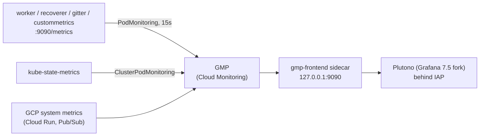

# OSV Monitoring (Metrics & Dashboards)

This directory holds the Grafana-compatible dashboard stack for OSV. Go services expose
Prometheus metrics, Google Cloud Managed Service for Prometheus (GMP) scrapes them, and
dashboards query them through a GMP frontend.

> **Note**: The stack currently lives only in the `oss-vdb-test` environment. It is included
> from [`../kustomization.yaml`](../kustomization.yaml) and served at
> `https://monitoring.test.osv.dev`. The production (`oss-vdb`) overlay does not include the
> dashboards or the `PodMonitoring` resource in this directory.

## Architecture



- **Metrics exposition**: [`go/internal/metrics`](../../../../../../go/internal/metrics/) defines
  every OSV metric and serves `/metrics` (plus `/healthz`) on port `9090` (`METRICS_PORT`).
  `worker`, `recoverer`, `gitter`, and `custommetrics` call `metrics.StartMetricsServer`, and each
  of their pods declares a container port named `metrics`.
- **Scraping**: [`worker_pod_monitoring.yaml`](worker_pod_monitoring.yaml) is a GMP
  `PodMonitoring` that scrapes the `metrics` port every 15s on pods whose `name` label is one of
  `worker-private`, `workers-reimport`, `workers-cves`, `recoverer`, `gitter`, or `custommetrics`.
- **kube-state-metrics**: [`base/ksm/`](../../../base/ksm/) deploys KSM to every environment.
  Its `ClusterPodMonitoring` keeps only `kube_(cronjob|pod|job|deployment)*` series to keep
  costs down.
- **Grafana**: [`grafana_deployment.yaml`](grafana_deployment.yaml) runs
  [Plutono](https://github.com/credativ/plutono), an Apache 2.0 fork of Grafana 7.5. It
  replaced upstream Grafana in #6311. Configuration uses `PL_*` environment variables and
  `/etc/plutono/...` paths. A `gmp-frontend` sidecar proxies PromQL queries to Cloud Monitoring
  for project `oss-vdb-test`.
- **Access**: [`grafana_ingress.yaml`](grafana_ingress.yaml) puts the service behind IAP with a
  managed certificate. Plutono trusts the `X-Goog-Authenticated-User-Email` header, so users are
  auto-created with the `Viewer` role. The login form and anonymous access are disabled.
- **Provisioning**:
  - [`configmaps/grafana_datasources.yaml`](configmaps/grafana_datasources.yaml) defines
    `GMP (Prometheus)` (uid `gmp`, default) and `Cloud Monitoring` (uid `cloud-monitoring`).
  - [`configmaps/grafana_dashboards_prov.yaml`](configmaps/grafana_dashboards_prov.yaml) loads
    every JSON file in `/etc/plutono/dashboards`, polling every 10s, with `editable: false`.
  - [`kustomization.yaml`](kustomization.yaml) generates the `grafana-dashboards` ConfigMap from
    `dashboards/*.json` with `disableNameSuffixHash: true`. Dashboard changes therefore sync in
    place without restarting the pod.

## Dashboard inventory

| File | Title (uid) | Purpose |
| :--- | :--- | :--- |
| [`home.json`](dashboards/home.json) | OSV.dev Observability Directory (`osv-home`) | Default home page. It links to the other dashboards and shows four at-a-glance stats. |
| [`executive-overview.json`](dashboards/executive-overview.json) | 1. Executive Overview & SLAs (`osv-exec-overview`) | SLOs and KPIs: worker success rate, API availability and p99 latency (Cloud Run), throughput, and published-to-available lag. |
| [`pipeline-ingestion-ops.json`](dashboards/pipeline-ingestion-ops.json) | 2. Ingestion & Worker Pipeline Operations (`osv-pipeline-ingestion-ops`) | Pub/Sub backlog, worker replicas (KSM), task latency and failures, reconciler and deleter health. |
| [`data-quality-drift.json`](dashboards/data-quality-drift.json) | 3. Vulnerability Data Quality & Ecosystem Health (`osv-data-quality-drift`) | Dataset size, Datastore vs. GCS drift, linter findings, feed freshness, Gitter activity, and export `all.zip` size. |

## Adding a new metric

1. **Choose where to emit the metric.**
   - **In-process**: Use this for events in a long-running service (`worker`, `recoverer`,
     `gitter`), such as task counts, latencies, and errors. Record the value at the call site.
   - **[`custommetrics`](../../../../../../go/cmd/custommetrics/) collector**: Use this for batch
     or dataset state. CronJobs exit too quickly for GMP to scrape them. Instead, have the job
     persist a summary (for example, in `JobData` in Datastore). Then read it in
     [`collector.go`](../../../../../../go/cmd/custommetrics/collector.go), which polls Datastore
     and GCS every 5 minutes and sets gauges.
2. **Define the metric** in [`metrics.go`](../../../../../../go/internal/metrics/metrics.go) with
   `promauto`, so it is registered with the default registry that `/metrics` serves. Follow the
   existing conventions:
   - Use the `osv_<component>_<name>` naming format.
   - Counters end in `_total`. Gauges do not.
   - Use base units (`_seconds`, `_bytes`).
   - Keep label cardinality low (for example, `source`, `status`, or `error_type`, never record
     IDs).
   - Add a `Record...` helper that defaults empty labels.
   - For counters with known label values, pre-initialize them in `initDefaultSeries()`, so
     panels show `0` instead of "No data".
3. **Test it**: Extend
   [`metrics_test.go`](../../../../../../go/internal/metrics/metrics_test.go) (or
   `collector_test.go`) to assert the exposition output.
4. **Make sure the pod gets scraped.** If you emit from a new service:
   - Call `metrics.StartMetricsServer(ctx, port)` from its `main`.
   - Add a `metrics` container port (`9090`) to its manifest.
   - Add its pod `name` label to [`worker_pod_monitoring.yaml`](worker_pod_monitoring.yaml).
5. **Chart it**: Add or update a panel (see below). In PromQL, use the raw metric name (for
   example, `rate(osv_worker_tasks_processed_total[5m])`). GCP system metrics use the GMP form
   (for example, `run_googleapis_com:request_count`).

## Editing dashboards

1. Run Plutono locally against live GMP data:

   ```bash
   gcloud auth application-default login   # required: the script copies your ADC into the containers
   make run-grafana-local                  # defaults to oss-vdb-test; or: make run-grafana-local ARGS=oss-vdb
   ```

   The script ([`tools/run_grafana_local.sh`](../../../../../../tools/run_grafana_local.sh)) does
   the following:
   - Starts the same `gmp-frontend` and Plutono images on a private Docker network.
   - Serves Plutono on `http://localhost:3000` with anonymous Admin access.
   - Mounts `dashboards/` read-only.

   You need Docker and read access to Cloud Monitoring in the target project.
2. Edit the dashboard in the UI. Then open **Dashboard settings → JSON Model**, copy the JSON,
   and overwrite the matching file in [`dashboards/`](dashboards/). The local provisioner
   re-reads the files every 10s, so you can reload to verify the result.
3. Follow these rules:
   - **Keep `uid` stable.** `home.json` links to the other dashboards by `/d/<uid>`.
   - Reference the datasource as `GMP (Prometheus)`, which is how the existing panels refer to it.
   - Don't commit local-only changes such as `editable` or an `id`.
4. **To add a new dashboard file**, also add it to the `configMapGenerator` list in
   [`kustomization.yaml`](kustomization.yaml). Otherwise, it won't be deployed. The home page's
   dashboard list updates automatically, but the "Where Should I Start?" table in `home.json`
   is written by hand.
5. **Validate**: Run `kubectl kustomize deployment/clouddeploy/gke-workers/environments/oss-vdb-test`
   and check that the JSON parses. Changes deploy through the normal `gke-workers` Cloud Deploy
   rollout to `oss-vdb-test`.
