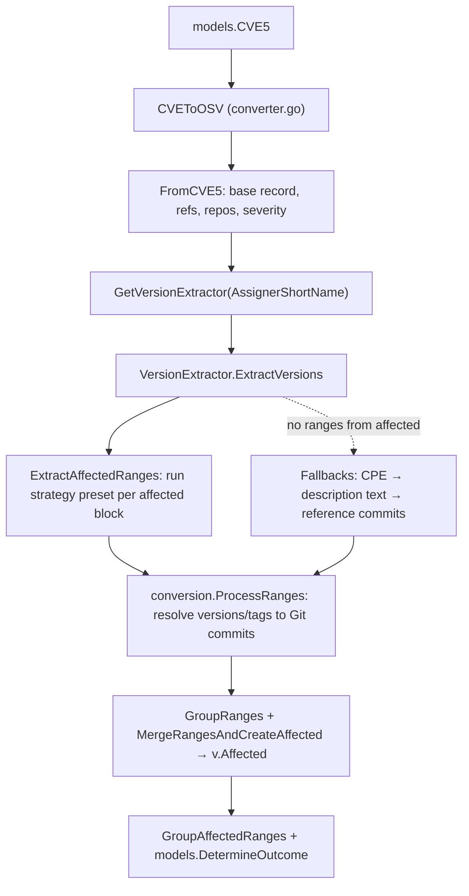

# CVE5 → OSV Conversion: Version Extraction

This package converts a single [CVE List V5](https://github.com/CVEProject/cvelistV5) record (`models.CVE5`) into an OSV record. This guide covers the **version extraction** part of the conversion. Each CNA (assigner) gets a `VersionExtractor`, and each extractor runs an ordered pipeline of `VersionStrategy` implementations over the record's `affected` blocks.

For the command-line tools that call this package, see [`cmd/converters/cve/cve5`](../../cmd/converters/cve/cve5/README.md).

## Pipeline overview



1. [`CVEToOSV`](converter.go) builds the base record with `FromCVE5`. `FromCVE5` also derives candidate repositories with `conversion.ReposFromReferencesCVEList`. `REJECTED` records stop here.
2. `GetVersionExtractor(cve.Metadata.AssignerShortName)` picks an extractor, and `ExtractVersions` adds entries to `v.Affected`.
3. `conversion.GroupAffectedRanges` merges ranges. `models.DetermineOutcome` then sets the final `ConversionMetrics.Outcome`.

## Extractors

[`extraction.go`](extraction.go) defines the extractor interface:

```go
type VersionExtractor interface {
    ExtractVersions(cve models.CVE5, v *vulns.Vulnerability, metrics *models.ConversionMetrics,
        repos []string, cache git.RepoTagsCache, httpClient *http.Client)
}
```

`GetVersionExtractor` maps the assigner name to an extractor. It lowercases the name and matches it in a `switch`:

| CNA (lowercased)       | Extractor                 | Strategy preset          |
| ---------------------- | ------------------------- | ------------------------ |
| `linux`                | `LinuxVersionExtractor`   | `strategies.Linux()`     |
| `github_m`, `github`   | `DefaultVersionExtractor` | `strategies.GitHub()`    |
| `mitre`                | `DefaultVersionExtractor` | `strategies.MITRE()`     |
| `curl`                 | `CurlVersionExtractor`    | `strategies.Curl()`      |
| _anything else_        | `DefaultVersionExtractor` | `strategies.Default()`   |

- **[`DefaultVersionExtractor`](default_extractor.go)** runs `ExtractAffectedRanges` on every `affected` block. It then calls `conversion.ProcessRanges` to resolve versions to commits. If nothing resolves, it tries these fallbacks in order:
  1. `strategies.CPEVersionExtraction`
  2. `conversion.ExtractVersionsFromText` on the English description
  3. `conversion.ExtractCommitsFromRefs` on CNA and ADP references

  If there are no repositories and no resolved versions, it exits early with outcome `NoRepos`. Ranges that can't be resolved are stored in `database_specific.unresolved_ranges`.
- **[`LinuxVersionExtractor`](linux_extractor.go)** builds `Linux`/`Kernel` ECOSYSTEM ranges, or GIT ranges that use the block's `repo`. It keeps only the first Git block and doesn't resolve tags. If no ranges are found, it falls back to CPEs.
- **[`CurlVersionExtractor`](curl_extractor.go)** handles curl records, which spread data across several `affected` blocks. If any block has Git versions, the extractor keeps only the Git ranges and attaches the plain enumerated versions as `affected[].versions`. If not, it delegates to `DefaultVersionExtractor`.

Use a dedicated extractor only when you need logic **across** `affected` blocks or a different output shape. Strategies only see one `models.Affected` block and can only emit ranges. If you only need different parsing rules, a new preset is usually enough.

## Strategies

[`strategies/strategy.go`](strategies/strategy.go) defines the strategy interface:

```go
type VersionStrategy interface {
    Name() string
    Extract(state *ExtractionState, metrics *models.ConversionMetrics)
}
```

`ExtractAffectedRanges` creates one `ExtractionState` per `affected` block and runs the strategies **in slice order**. Each strategy skips version entries that are already consumed (`state.IsConsumed(i)`). It records results with `state.Emit(ranges, indices...)` or `state.EmitAll(ranges)`. These calls mark entries as consumed only when they emit at least one range. The pipeline stops early once `state.AllConsumed()` is true. Most strategies handle one entry at a time through `ExtractPerVersion` and a `VersionExtractorFunc`.

| Strategy (`Name()`)                                           | Handles                                                                                    |
| ------------------------------------------------------------- | ------------------------------------------------------------------------------------------ |
| `SplitRangeStrategy` (`SplitRange`)                           | Ranges split across entries, where `lessThan`/`version` are `"unspecified"`                 |
| `ChangesAtStrategy` (`ChangesAt`)                             | A fixed version taken from `changes[]` where the status is `unaffected`                     |
| `StandardRangeStrategy` (`StandardRange`)                     | Standard `version` + `lessThan` / `lessThanOrEqual` ranges                                  |
| `StringRangeExpressionStrategy` (`StringRangeExpression`)     | Range expressions inside `version`, e.g. `">= 2.0, < 2.5"`                                  |
| `GitCommitStrategy` (`GitCommit`)                             | A Git commit version as a standalone commit (introduced = last_affected)                    |
| `GitCommitIntroducedOnlyStrategy` (`GitCommitIntroducedOnly`) | A Git commit as an introduced-only point (Linux)                                           |
| `CPEVersionStringStrategy` (`CPEVersionString`)               | `version` values written as CPE strings                                                     |
| `VersionTextExtractionStrategy` (`VersionTextExtraction`)     | Free-text versions, e.g. `"Fixed in version 2.4.1 and higher"`                              |
| `ZeroIntroducedSingleVersionStrategy` (`ZeroIntroducedSingleVersion`) | A single listed version as `introduced: 0` → `last_affected`                       |
| `StandaloneSingleVersionStrategy` (`StandaloneSingleVersion`) | A single exact version (introduced = last_affected)                                         |
| `InverseAffectedRangesStrategy` (`InverseAffectedRanges`)     | `defaultStatus: affected` blocks that list only unaffected versions; affected ranges are inferred |

`CPEVersionStrategy` (`CPEApplicability`) works differently: it reads the whole `models.CVE5` (CPE applicability statements and `affected[].cpes`), not one `affected` block. Extractors call it as a fallback through `CPEVersionExtraction`.

### Presets

[`strategies/presets.go`](strategies/presets.go) defines one function per CNA (`Default`, `GitHub`, `MITRE`, `Linux`, `Curl`). Each returns a `[]VersionStrategy`. **Order matters**: the first strategy to emit a range for an entry consumes it, so put more specific strategies before generic ones. Each preset's doc comment names example records in `test_data/`.

## Provenance and metrics

- **Range metadata**: Each extracted range is a `models.RangeWithMetadata`. Its `Metadata` holds `Source`, `Strategy`, `CPE`, `OriginalTag`, and `Versions`.
  - Strategies set `Source` through `conversion.ToRangeWithMetadata(ranges, models.VersionSource...)`.
  - `ExtractAffectedRanges` calls `state.SetStrategyFrom` to set `Strategy` to `Name()` on new ranges.
  - References resolved to commits get the source `REFERENCES_COMMIT` (`VersionSourceRefsCommit`) or `REFERENCES_TAG` (`VersionSourceRefsTag`), plus `original_tag`.
- **Output**: Each OSV range's `database_specific.extracted_events` lists groups of `{range, source, strategy, cpe, original_tag}`. Unresolved ranges use the same grouping under `database_specific.unresolved_ranges`. See `buildRangeDatabaseSpecific` and `CreateUnresolvedRanges` in [`../common.go`](../common.go).
- **Metrics**: `models.ConversionMetrics` collects:
  - Notes (`AddNotef`, including `"Strategy successful: <name>"`)
  - `VersionSources` (`AddSource`)
  - Resolved and unresolved range counts
  - An `Outcome`: `SetOutcome` only overwrites an unset outcome or replaces it with `Successful`. Outcomes include `Successful`, `NoRepos`, `NoCommitRanges`, `NoRanges`, and `Rejected`.

## Checklists

### Adding a CNA-specific pipeline or extractor

1. Try a new preset first. Add a function to [`strategies/presets.go`](strategies/presets.go), and link example records in its doc comment.
2. Add a `case` to `GetVersionExtractor` in [`extraction.go`](extraction.go). Use the lowercased `AssignerShortName`.
3. Only if you need logic across blocks, add `<cna>_extractor.go`:
   - Define a struct with a `Strategies []strategies.VersionStrategy` field.
   - Add `var _ VersionExtractor = &XVersionExtractor{}`.
   - Reuse `ExtractAffectedRanges`, `conversion.ProcessRanges`, `GroupRanges`, and `MergeRangesAndCreateAffected`.
   - Delegate to `DefaultVersionExtractor` when the special case doesn't apply.
4. Add a case to `TestGetVersionExtractor` and `TestExtractVersions*` tests in [`version_extraction_test.go`](version_extraction_test.go). Add a representative record to `vulnfeeds/test_data/cve5/` so `TestCVE5Snapshot` covers it.

### Adding a new strategy

1. Add a file in [`strategies/`](strategies/) with a struct that implements `Name()` and `Extract()`. Put an example CVE `versions` entry and the resulting OSV range in the doc comment, like the existing strategies.
2. Skip consumed entries, either by using `ExtractPerVersion` or by checking `state.IsConsumed`. Emit only through `state.Emit` / `state.EmitAll`, and tag ranges with a `models.VersionSource` through `conversion.ToRangeWithMetadata`.
3. Add the strategy to the presets that need it, at the right position.
4. Add unit tests in [`strategies/strategies_test.go`](strategies/strategies_test.go). Regenerate the snapshots and review the `extracted_events` / `strategy` changes.

## Testing

```bash
cd vulnfeeds
go test ./conversion/cve5/...
```

- **Fixtures**:
  - Full CVE5 records live in `vulnfeeds/test_data/cve5/` (used by `TestCVE5Snapshot`) and `vulnfeeds/test_data/cvelistV5/cves/<year>/<Nxxx>/` (loaded with `loadTestData`).
  - HTTP and Git traffic is replayed from go-vcr cassettes in [`testdata/`](testdata/). There is one cassette per test name (`testutils.SetupVCR` / `SetupGitVCR`).
- **Snapshots**: `TestCVE5Snapshot` uses [go-snaps](https://github.com/gkampitakis/go-snaps). Its output is stored in [`__snapshots__/converter_test.snap`](__snapshots__/converter_test.snap). After an intended output change, run `UPDATE_SNAPS=true go test ./conversion/cve5/...` and review the `git diff` carefully.
